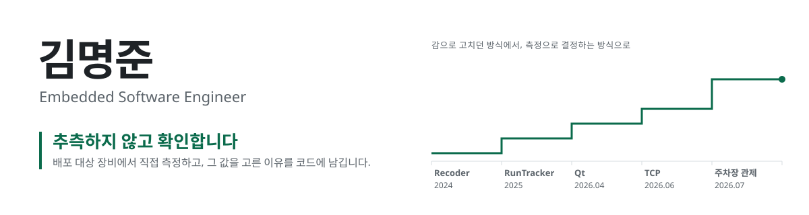

<picture>
  <source media="(prefers-color-scheme: dark)" srcset="./assets/banner-dark.svg">
  
</picture>

  
  

라즈베리파이 위에서 RTSP 메타데이터 수신, 다채널 데이터 집계, 장치 제어 데몬을 설계하고 구현했습니다.
팀장으로서는 인터페이스와 데이터 계약을 먼저 정해, 팀원들이 서로의 완성을 기다리지 않고 동시에 개발할 수 있게 하는 데 집중해 왔습니다.

 

## 확인해서 고친 것

| | 무엇을 바꿨나 | 측정 환경 |
|:--|:--|:--|
| **71.95 → 2.92µs** | 집계기 락 보유 시간 95.9% 감소. 윈도우 마감 콜백을 락 밖으로 옮겨 채널 간 블로킹 제거 | Pi 실측 |
| **6.52 → 2.04회** | 프레임당 `recv()` 호출. 64KB 버퍼 단위로 읽고 루프 안 재할당 제거 | Pi 실측 |
| **10초마다 끊김** | 원인은 버려지던 RTSP 세션 `timeout` 필드. keep-alive를 `min(설정값, timeout ÷ 2)`로 (RFC 2326 §12.37) | CCTV 연동 |
| **경보 누락 경로** | 정상 값(`gid = 0`)만으로 경보가 사라지던 위험 판정 결함 수정, 회귀 테스트로 고정 | 재현 테스트 |
| **NaN 결함 재검증** | 직접 쓴 감사 결론을 변이 테스트로 반증하고 문서를 정정 | 변이 테스트 |

나빠진 수치(p50 40ns 악화)와 측정으로 기각한 최적화(이득 0.3%)도 함께 기록했습니다.

 

## Projects

### [AI 주차장 안전 관제 시스템](https://github.com/VEDA-TEAM3/Main_Project)

`2026.07 – 08` · 5명 · **팀장** · C++20 · MQTT(TLS) · RTSP/ONVIF · GoogleTest

여러 CCTV의 객체 메타데이터를 하나의 도면 좌표계로 모아 차량과 보행자의 충돌 위험을 판정하고, 관제 화면과 현장 경보 장치로 보냅니다.

- 두 서버의 역할과 파이프라인 인터페이스를 설계하고, Stub으로 흐름을 먼저 검증한 뒤 구현을 팀원과 나눔
- 서버 간·장치 간 데이터 계약(`shared/`) 정의, compute-server·control-server 핵심 모듈 구현
- 프레임 경로 힙 할당 0 규칙과 버퍼 풀, GitHub Actions CI 4종(build, ci, format, tidy)
- Docker·QEMU 기반 팀 공용 크로스 컴파일 환경, Python 호모그래피 캘리브레이션 도구

### [TCP 기반 원격 장치 제어](https://github.com/Mangjun/rpi4-tcp-gpio-program)

`2026.06` · 개인 · C11 · epoll · pthread · HTTP·SSE

라즈베리파이에 연결된 LED, 부저, 조도 센서, 7세그먼트를 TCP 클라이언트와 웹 브라우저에서 제어하는 데몬입니다. 접속마다 스레드를 만들던 구조를 epoll 단일 루프로 바꾸고, 하드웨어 제어는 `.so`로 분리했습니다.

### [Qt 일정 관리 앱](https://github.com/Mangjun/12_qt_project)

`2026.04` · 2명 · C++ · Qt

작은 기기에서 돈다는 가정으로 DB 대신 사용자별 파일 구조를 쓰고, `DataManager` 추상화로 저장 방식을 교체할 수 있게 했습니다.

### [RunTracker](https://github.com/HHG-RunTracker/RunTracker-AI-Server) 동양미래대학교 졸업작품

`2025.04 – 12` · 4명 · **팀장** · FastAPI · scikit-learn · OSMnx · OpenCV · Docker Compose

아키텍처·DB 설계와 개발 인프라를 맡고, 팀에 비어 있던 추천 서버(코사인 유사도 코스 추천, 경로 형상 매칭)를 직접 구현했습니다.

### [Recoder](https://github.com/Mangjun/Recoder) 유한대학교 졸업작품

`2024` · 1차 6명 / 2차 5명 · **팀장** · Spring Boot · JPA · MySQL · Android · AWS

추억 공유 앨범 앱. 서버 전체와 DB 설계, 안드로이드 대부분을 맡아 배포까지 완성했습니다.

 

## Tech Stack

  

| 영역 | 기술 |
|:--|:--|
| 언어 | C11, C++20, Python, Java |
| 시스템 | Linux, epoll, pthread, 시그널, 데몬화, `dlopen` |
| 통신 | TCP/IP, RTSP/RTP, ONVIF, MQTT(TLS), HTTP·SSE |
| 하드웨어 | Raspberry Pi 4, GPIO, I2C, UART 프레임 규약 |
| 빌드·검증 | CMake, Makefile, GoogleTest, GitHub Actions, clang-format, clang-tidy |
| 배포 | Docker, buildx·QEMU, Docker Compose, logrotate |
| 데이터베이스·저장소 | MySQL, Oracle, SQLite, Redis, AWS S3 |

 

## 교육·자격

| | |
|:--|:--|
| **2026.03 – 2026.09** | 한화비전 Vision's Edge Device Academy 4기 수료 · 협업왕상 |
| **2025.09** | 정보처리기사 |
| **2025.03 – 2026.02** | 동양미래대학교 컴퓨터소프트웨어공학과 학사 (전공심화) |
| **2022.03 – 2025.02** | 유한대학교 컴퓨터소프트웨어공학과 전문학사 |
